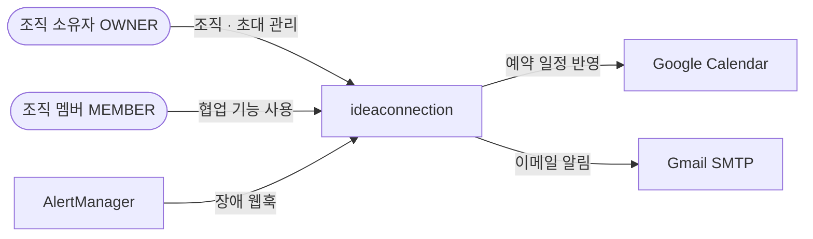
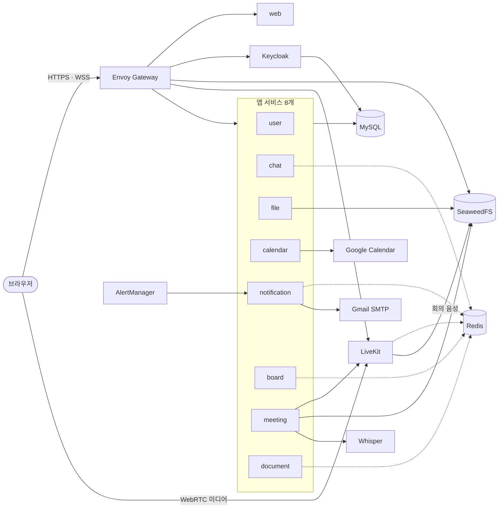
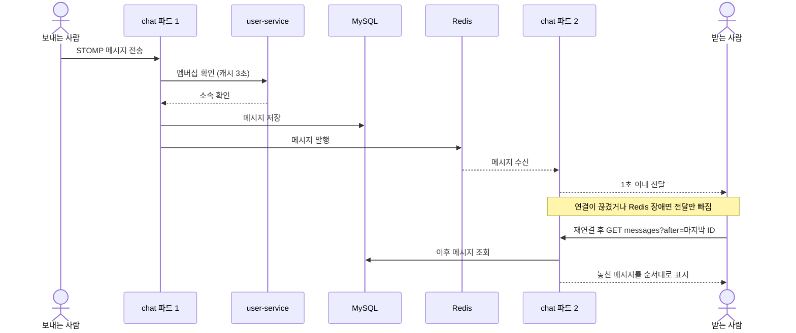
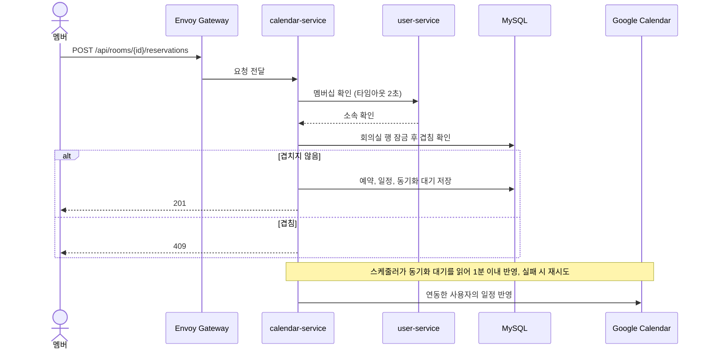
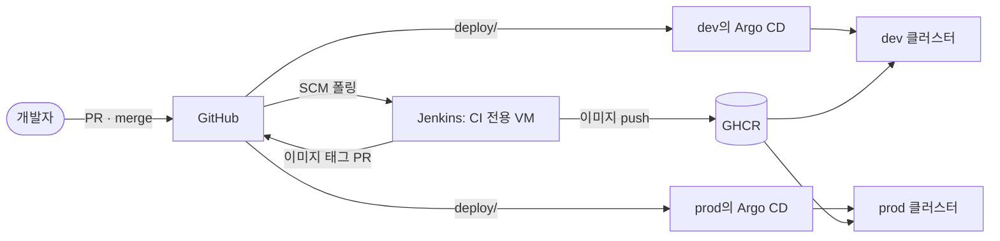

# 아키텍처

[← 요구사항](requirements.md) · [README](../README.md) · 다음: [기술 스택](tech-stack.md)

> 기획서와 요구사항을 반영한 초안입니다. 학습 프로젝트이므로 쉬운 방향을 우선했고, 구현하며 배운 내용에 따라 고칩니다.

## 1. 시스템 컨텍스트

- AlertManager는 팀이 운영하지만 제품 기능이 아니므로 바깥에 둡니다
- 웹 알림은 우리 서비스의 WebSocket으로 보내므로 외부 푸시 서비스가 없습니다

## 2. 서비스 구성도

실선은 동기 호출, 점선은 pub/sub입니다.

| 서비스 | 책임 | database · 테이블 |
|---|---|---|
| `user-service` | 프로필, 조직, 초대, 멤버와 역할(OWNER, MEMBER) | `user_service`: `profile`, `organization`, `membership`, `invitation` |
| `chat-service` | 채널, 메시지, WebSocket(STOMP), 결정 로그, 확인 요청, 이모지 | `chat_service`: `channel`, `channel_member`, `message`, `decision`, `message_ack`, `message_reaction` |
| `file-service` | presigned URL 발급, 업로드 완료 확인, 목록과 삭제, 미리보기(PDF, 이미지, 텍스트) | `file_service`: `file_object` |
| `calendar-service` | 팀 · 개인 일정, 회의실 예약, Google Calendar 반영 | `calendar_service`: `calendar_event`, `room`, `reservation`, `google_link`, `google_sync_job` |
| `notification-service` | 예약 · 즉시 알림, 수신 경로, 근무시간, 장애 알림 수신 | `notification_service`: `notification`, `notification_setting` |
| `board-service` | 보드, 컬럼, 카드, 순서, 담당자, 기간, 타임라인, 변경 실시간 전달 | `board_service`: `board`, `board_column`, `card` |
| `meeting-service` | 회의방, LiveKit 입장 토큰 서명(유효 1분), 회의 음성 수집과 변환 요청, 전사 조회 | `meeting_service`: `meeting`, `transcript`, `transcript_job` |
| `document-service` | 문서 · 드로잉 목록, 실시간 공동 편집(Yjs) | `document_service`: `document` |

음성 변환은 meeting-service가 맡습니다. 스케줄러가 회의 음성을 Whisper 컨테이너로 보내 결과를 저장하고 원본 음성을 삭제합니다.

서비스 간 동기 호출은 아래만 허용합니다. 타임아웃은 2초이고 재시도하지 않으며, 실패하면 503을 반환합니다. 오래 걸리는 Whisper 변환 요청은 이 규칙에서 제외합니다.

| 호출 | 목적 | 비고 |
|---|---|---|
| 모든 조직 서비스 → user | 멤버십 확인 | 캐시 TTL 3초, 확인할 수 없으면 접근 차단 |
| chat → board | 메시지를 카드로 변환(US-09) | 카드에 원본 메시지 ID 저장 |
| notification → user | 이메일 수신자 주소 조회 | |

- 사용자 ID는 Keycloak `sub`를 그대로 쓰고, 이메일은 첫 로그인 때 `profile`에 저장합니다
- 다른 서비스의 데이터는 ID로만 참조합니다. 서비스 간 외래 키와 JOIN은 금지합니다
- 파드가 여러 개인 예약 알림과 Google 반영은 DB 작업 테이블을 `SKIP LOCKED`로 읽어 중복 처리를 막습니다
- 운영 담당자는 조직 역할이 아니라 notification 설정의 사용자 ID 목록으로 관리합니다
- 영상은 녹화하지 않습니다. 음성 변환을 위해 회의 음성만 임시 저장하고, 변환 후 삭제합니다

## 3. 핵심 시나리오 시퀀스

### 채팅 전달과 복구 (US-06, US-07)

### 회의실 예약과 Google 반영 (US-15, US-16)

## 4. 배포 구성도

- PR: Jenkins가 변경된 부분만 검증합니다. `services/`는 빌드, 테스트, 린트를, `deploy/`는 `validate.sh`를 실행합니다
- `main` 머지: `services/`가 바뀌면 이미지를 커밋 SHA 태그로 push하고 dev의 `image.tag` 변경 PR을 만듭니다. 이 PR을 리뷰 후 머지하면 Argo CD가 동기화합니다
- prod 반영: dev에서 확인한 이미지 태그를 스프린트 데모 전에 PR로 올립니다
- 구성: Argo CD는 클러스터마다 하나씩 둡니다. dev와 prod는 각각 control plane 1대와 워커 2대입니다
- 롤백: `git revert` 후 머지

## 5. 네트워크 · 보안

- 외부 진입점: Envoy Gateway 하나로 HTTPS · WSS를 받습니다. 화상 미디어만 예외로 LiveKit 전용 IP에 WebRTC로 직접 연결합니다
- 외부 접속: 서비스는 내부망(MetalLB 사설 IP)에만 두고, 외부에서는 bastion을 거쳐 접속합니다
- 라우팅: `/api/users/me/working-hours`와 `/api/users/me/notification-channels`는 notification으로, `/api/users/me/google-calendar`는 calendar로, 나머지 `/api/users`는 user로 보냅니다
- 메시: Envoy Gateway와 앱 서비스를 넣고 mTLS STRICT를 적용합니다. Envoy Gateway와 메시의 연결 방식은 구축할 때 검증합니다. MySQL, Redis, SeaweedFS, Keycloak, LiveKit, Whisper, 관측 도구는 메시 밖에 둡니다
- 허용 통신: 2번의 호출 표를 Istio `AuthorizationPolicy`로 적용합니다. NetworkPolicy는 쓰지 않습니다
- 내부 경로: `/internal/*`은 Gateway에 노출하지 않습니다. AlertManager와 LiveKit 웹훅은 메시 밖에서 오므로 전용 포트로 받고 토큰이나 서명을 검증합니다
- 권한 회수: REST와 STOMP는 요청마다 멤버십을 확인합니다. presigned URL은 5분, LiveKit 입장 토큰은 1분만 유효합니다. 이미 연결된 화상 · 문서 세션은 다음 접속부터 차단합니다
- 비밀값: Kubernetes Secret에 둡니다. 대상은 DB 계정, Keycloak, Google OAuth, LiveKit 키, SMTP, S3 키, Discord 웹훅, 웹훅 토큰입니다. Google 토큰은 암호화해 DB에 저장합니다

## 6. 관측 구성

- 지표: 서비스의 `/metrics`를 Prometheus가 수집하고 Grafana에서 봅니다. 서비스 간 통신은 Kiali에서 봅니다
- 로그: 모든 서비스가 같은 JSON 형식으로 남기고, Alloy가 수집해 Loki에 저장합니다. 요청 ID로 추적하며 분산 추적 도구는 쓰지 않습니다
- 알림: 에러율 5%가 5분을 넘으면 AlertManager가 notification과 Discord로 동시에 보냅니다. Discord는 클러스터나 notification이 죽었을 때를 대비한 경로입니다
- 보관: 지표와 로그는 7일 보관합니다

자세한 기준은 [관측 설계](observability.md)에 있습니다.
