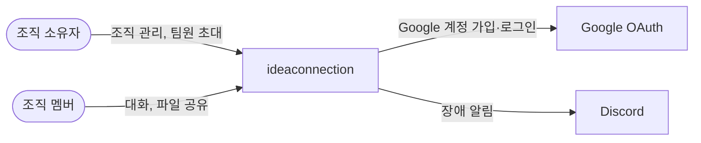
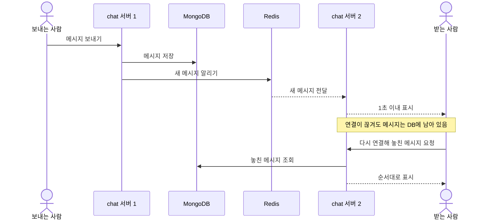
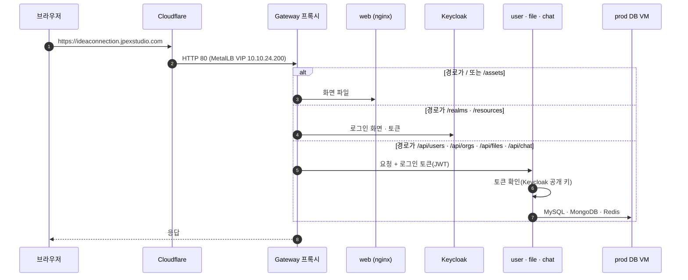
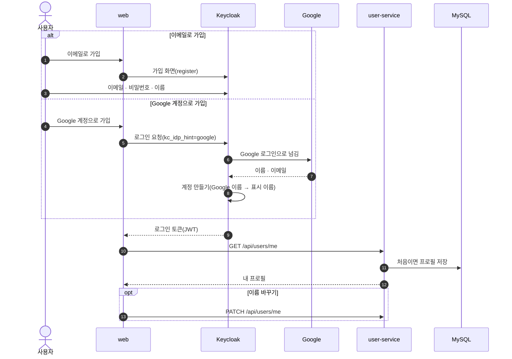
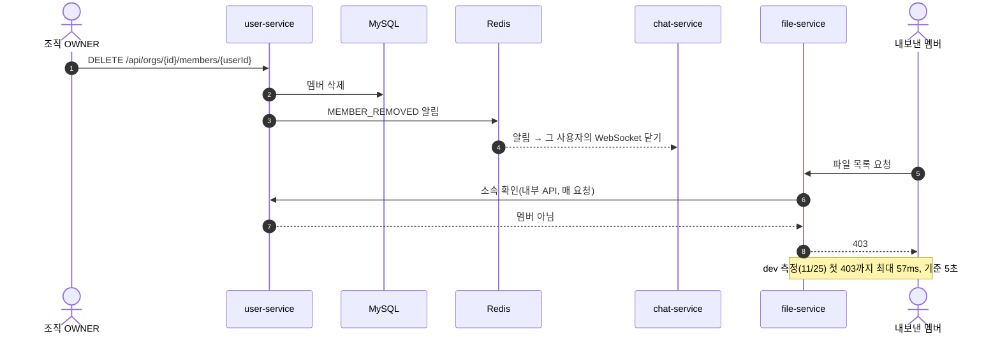
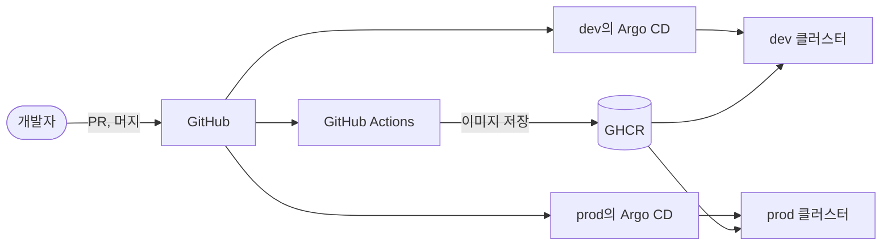

# 아키텍처

[← 요구사항](requirements.md) · [README](../README.md) · 다음: [기술 스택](tech-stack.md)

> 시스템의 큰 구조만 적습니다. 세부 설계는 담당자가 구현하면서 정하고, 배운 내용에 따라 고칩니다.

## 1. 시스템 컨텍스트

우리 시스템을 누가 쓰고, 어떤 외부 시스템과 연결되는지 보여 줍니다.

## 2. 서비스 구성도

시스템 안에 무엇이 있고 어떻게 연결되는지 보여 줍니다.

```mermaid
flowchart LR
  subgraph apps[서비스 3개]
    us[user]
    cs[chat]
    fs[file]
  end
  subgraph dbvm[DB 전용 VM · 클러스터 밖]
    my[(데이터: MySQL)]
    mg[(데이터: MongoDB)]
    rd[(실시간 전달: Redis)]
  end
  user([브라우저]) --> gw[입구: Envoy Gateway]
  gw --> web[웹 화면]
  gw --> kc[로그인: Keycloak]
  kc -->|외부 로그인| gg([Google OAuth])
  gw --> apps
  gw --> sw[(파일: SeaweedFS)]
  us & fs --> my
  cs --> mg
  us & cs --> rd
  fs --> sw
```

| 서비스 | 하는 일 | 요구사항 |
|---|---|---|
| user | 프로필, 조직, 초대, 멤버 권한 | US-01 ~ US-05 |
| chat | 채널, 실시간 대화, 결정 기록, 확인 요청 | US-06, US-07, US-08, US-10, US-11 |
| file | 파일 업로드, 다운로드, 미리보기, 삭제 | US-08, US-12 |

MySQL, MongoDB, Redis는 클러스터 밖 DB 전용 VM에 Docker로 둡니다. 클러스터를 다시 만들어도 데이터가 남고, 세 DB를 같은 방법으로 관리할 수 있습니다. **포기하는 점:** VM이 하나라서 그 VM이 멈추면 모든 서비스가 데이터를 쓰지 못하고, 자동으로 복구되지 않습니다.

서비스 사이의 약속입니다.

- 서비스마다 자기 데이터만 직접 다룹니다. 다른 서비스의 데이터가 필요하면 그 서비스에 요청합니다
- 서비스끼리는 조직 소속 확인(chat, file → user) 하나만 호출합니다. 이때 사용자의 로그인 토큰을 그대로 넘깁니다
- 그 밖에 모니터링을 위한 호출(Prometheus → 서비스)을 허용합니다
- 소속 확인 결과는 기억하지 않고 요청마다 확인합니다. 멤버가 나가면 다음 요청부터 바로 막기 위해서입니다(dev 측정 11/25: 첫 403까지 최대 57ms, 기준 5초)
- 소속 확인은 새 요청만 막습니다. 그래서 멤버가 나가면 user가 Redis로 알리고, chat이 그 사용자의 실시간 연결을 끊습니다

## 3. 핵심 시나리오

### 채팅 전달과 복구 (US-06, US-07)

메시지를 먼저 저장하므로, 연결이 끊겨도 다시 연결하면 놓친 메시지를 볼 수 있습니다.

### 요청이 들어오는 길 (prod)

주소의 경로에 따라 Gateway가 화면 · 로그인 · API로 나눠 보냅니다. 서비스는 Keycloak 공개 키로 로그인 토큰을 직접 확인합니다.

### 가입 · 로그인 (US-01)

이메일로 가입하든 Google 계정으로 가입하든 토큰은 Keycloak이 발급하므로, 서비스 쪽 확인 방법은 같습니다. 처음 로그인하면 user가 프로필을 만들고, 표시 이름은 나중에 바꿀 수 있습니다.

### 권한 회수 (US-04)

file · chat은 요청마다 user에 소속을 확인하므로, 멤버를 내보내면 다음 요청부터 바로 403이 됩니다. 이미 열린 채팅 연결은 Redis 알림을 받은 chat이 끊습니다.

## 4. 배포 구성도

코드가 서버에 올라가는 과정입니다.

1. 개발자가 PR을 올리면 GitHub Actions가 코드를 검사합니다
2. 머지하면 GitHub Actions가 이미지를 만들어 GHCR에 저장하고, dev의 이미지 번호를 바꿔 `main`에 바로 올립니다
3. 그러면 Argo CD가 dev에 배포합니다
4. dev에서 확인한 이미지는 스프린트 데모 전에 PR로 prod에 올립니다
5. 문제가 생기면 `git revert`로 되돌립니다

### 인프라 구성

prod와 dev는 같은 내부망(10.10.24.0/24)에 노드 3대(control plane 1, 워커 2)씩 두고, DB는 환경마다 클러스터 밖 전용 VM에 둡니다. prod만 Cloudflare 터널로 외부에 열고, dev는 팀원이 bastion을 거쳐서만 씁니다. 서비스 사이 보안(Istio)과 로그 수집(Loki)은 지금 dev에만 있습니다.

### 노드 배치

2026-11-25 `kubectl get pods -A` 기준입니다. prod 앱은 두 워커에 하나씩 나눠 떠서, 노드 하나가 멈춰도 서비스가 남습니다. 모든 노드에 하나씩 도는 시스템 파드(calico-node, kube-proxy, MetalLB speaker 등)는 표에서 뺐습니다.

| 환경 · 노드 | 주소 | 이 노드에서 도는 것 |
|---|---|---|
| prod cp | .21 | 쿠버네티스 관리(etcd, apiserver 등). 앱 pod 없음 |
| prod w1 | .22 | web · user · file · chat 각 1, Keycloak, SeaweedFS(master · filer), Grafana, Argo CD 일부, Envoy Gateway 컨트롤러 |
| prod w2 | .23 | Gateway 프록시(요청 입구), web · user · file · chat 각 1, SeaweedFS(volume · s3), Prometheus · AlertManager, Argo CD 서버, MetalLB 컨트롤러 |
| prod DB VM | .20 | MySQL 8.4(user · file · Keycloak), MongoDB 8.0(chat), Redis 8.10. Docker |
| dev cp | .11 | 쿠버네티스 관리. 앱 pod 없음 |
| dev w1 | .12 | Gateway 프록시(요청 입구), web · user(HPA 1~3) · file · chat 각 1(user · file · chat에 Istio 사이드카), Loki · Alloy, Prometheus · AlertManager, SeaweedFS master |
| dev w2 | .13 | chat 1, Keycloak(+Postgres), istiod, Grafana, SeaweedFS(filer · volume · s3), Argo CD 서버 |
| dev DB VM | .10 | MySQL 8.4, MongoDB 8.0, Redis 8.10. Docker |

| 앱 pod | dev | prod | 비고 |
|---|---|---|---|
| web | 1 | 2 | nginx, 화면 파일 |
| user-service | 1~3 (HPA) | 2 | dev는 부하 테스트로 CPU 요청을 실사용에 맞춤 |
| file-service | 1 | 2 | 요청마다 user에 소속 확인 |
| chat-service | 2 | 2 | 두 파드가 Redis로 새 메시지를 주고받음 |
| keycloak | 1 | 1 | dev는 자체 Postgres, prod는 DB VM의 MySQL |

### 네임스페이스

우리 앱은 환경별 네임스페이스 하나에 모으고, 운영 도구는 도구마다 따로 둡니다. 클러스터 기본 구성을 빼면 모두 Argo CD가 `deploy/` 내용대로 설치합니다.

| 네임스페이스 | dev | prod | 들어 있는 것 |
|---|---|---|---|
| `ideaconnection-dev` · `ideaconnection-prod` | O | O | web, user-service, file-service, chat-service. prod는 Keycloak도 여기에 둡니다. dev는 user · file · chat에 Istio 사이드카를 붙입니다 |
| `keycloak` | O | | Keycloak과 전용 Postgres (dev만) |
| `envoy-gateway-system` | O | O | Envoy Gateway 컨트롤러와 Gateway 프록시(요청 입구, MetalLB VIP). 경로 규칙은 web · Keycloak · user · file · chat · SeaweedFS S3로 나눕니다 |
| `istio-system` | O | | istiod(사이드카 설정 · 인증서) |
| `seaweedfs` | O | O | master, filer, volume, s3(파일 내용 저장) |
| `monitoring` | O | O | Prometheus, AlertManager, Grafana, Prometheus Operator, kube-state-metrics, node-exporter. 경보 규칙과 Discord 연결은 dev |
| `logging` | O | | Loki, Alloy(파드 로그 수집) |
| `argocd` | O | O | server, application-controller, repo-server, applicationset, redis, dex, notifications. 클러스터마다 하나씩 |
| `loadtest` | O | | k6 Job. 측정할 때만 올리고 끝나면 지웁니다 |
| `kube-system` 등 기본 구성 | O | O | CoreDNS, kube-proxy, Calico(파드 네트워크), MetalLB, local-path(노드 디스크 저장), metrics-server(dev). 클러스터를 만들 때 손으로 설치합니다(`deploy/cluster`) |

## 5. 네트워크 · 보안

### 네트워크

- 사용자 요청은 Envoy Gateway 하나로 들어오고 암호화된 통신만 허용합니다
- 서버는 내부망에만 두고, 팀원이 서버를 관리할 때는 bastion(중계 서버)을 거쳐 접속합니다
- prod는 공개 주소 `https://ideaconnection.jpexstudio.com`으로 엽니다. 공인 IP 없이 Cloudflare가 HTTPS 접속을 받아 Gateway로 넘겨 주고, 데모도 이 주소로 합니다. dev는 내부망에서만 씁니다

팀에 주어진 대역 하나(10.10.24.0/24)를 역할별로 나눠 씁니다. 주소만 봐도 dev(.1x · .10x)와 prod(.2x · .20x)를 구분할 수 있습니다.

| 구역 | 주소 | 구성 |
|---|---|---|
| 팀 내부망 | 10.10.24.0/24 | VM 전부. bastion으로만 접속 |
| DB VM | .10 (dev) · .20 (prod) | MySQL · MongoDB · Redis (Docker) |
| dev 노드 | .11 ~ .13 | cp · w1 · w2 |
| prod 노드 | .21 ~ .23 | cp · w1 · w2 |
| dev 입구 VIP | .101 (풀 .100 ~ .127) | MetalLB → Envoy Gateway. 내부망만 |
| prod 입구 VIP | .200 (풀 .200 ~ .223) | MetalLB → Envoy Gateway. Cloudflare 터널의 목적지 |
| Pod · Service 네트워크 | 10.244.0.0/16 · 10.96.0.0/12 | Calico(VXLAN), Service는 kubeadm 기본값 |

| 출발 → 도착 | 프로토콜 · 포트 | 용도 |
|---|---|---|
| 인터넷 → Cloudflare | HTTPS 443 · WSS | 웹, 로그인, API, 채팅 |
| Cloudflare 터널 → prod Gateway(.200) | HTTP 80 | 인증서는 Cloudflare가 처리 |
| Gateway → web · Keycloak · user · file · chat | HTTP | 경로별로 나눔(/ · /realms · /api/…) |
| file · chat → user 내부 API | HTTP | 소속 확인 |
| 앱 pod → DB VM | 3306 · 27017 · 6379 | MySQL · MongoDB · Redis. 서비스마다 DB 계정 분리 |
| Prometheus → DB VM | 9100 · 9104 · 9216 · 9121 | DB 지표 수집 |
| 팀원 PC → bastion → 각 VM | SSH | 관리 접속 |

### 인증

- 가입과 로그인은 Keycloak이 처리합니다. 가입은 이메일 또는 Google 계정(OAuth 연동) 중 고르고, 우리 서비스 DB에는 비밀번호를 저장하지 않습니다
- 브라우저는 Keycloak이 발급한 로그인 토큰(JWT)을 `Authorization: Bearer` 헤더로 보냅니다. Gateway는 경로만 나누고, 각 서비스가 Keycloak 공개 키로 서명과 만료를 확인해 토큰이 없거나 잘못되면 401을 돌려줍니다
- WebSocket은 연결한 뒤 인증 메시지로 토큰을 보냅니다. 토큰은 로그에 남을 수 있어 주소에 넣지 않습니다
- prod 웹 화면용 클라이언트는 Keycloak 로그인 화면을 거치는 방식(PKCE)만 쓰고, 아이디 · 비밀번호로 바로 토큰을 받는 방식은 꺼 둡니다. dev 부하 테스트는 전용 클라이언트(`k6-loadtest`)로 토큰을 받습니다

### 권한과 조직 격리

| 역할 | 할 수 있는 것 |
|---|---|
| OWNER | 멤버가 하는 일 전부, 조직 삭제, 초대 링크 생성, 멤버 제거, 다른 사람이 올린 파일 삭제 |
| MEMBER | 대화, 결정 로그 · 확인 요청, 파일 올리기 · 받기 · 미리보기, 내가 올린 파일 삭제, 탈퇴 |

- chat과 file은 조직 데이터 요청마다 user에 소속을 확인합니다(캐시 없음). 멤버가 아니면 403, user가 멈춰 확인할 수 없으면 503으로 막습니다. 확인 실패를 허용으로 넘기지 않습니다
- 모든 조직 데이터 조회에 조직 ID 조건을 넣습니다. 다른 조직의 ID를 넣어 불러도 소속 확인에서 막힙니다
- 멤버를 내보내면 user가 행을 지우고 Redis로 알려, chat이 그 사용자의 실시간 연결을 끊습니다. dev 측정(11/25)에서 첫 403까지 최대 57ms, WebSocket 종료 1ms였고, 조직 간 차단 측정에서 다른 조직 데이터 요청 18건이 모두 403이었습니다
- 초대 링크는 토큰 해시만 저장하고, 7일 뒤 만료되며 한 번만 쓸 수 있습니다. OWNER는 조직을 나갈 수 없습니다

### 서비스 사이 보안

- `/internal/...` 주소는 입구(Gateway)에서 외부 요청을 받지 않습니다
- 서비스끼리의 통신은 Istio로 암호화(mTLS)하고, user 내부 API는 chat과 file만 부를 수 있게 허용 정책을 둡니다. 지금은 dev에 적용했습니다(#217)
- DB 포트(3306 · 27017 · 6379)는 DB VM의 내부 IP에만 엽니다
- Grafana · Argo CD · Keycloak 관리 화면은 외부에 열지 않고 port-forward로만 봅니다

### 데이터와 비밀값

- 파일은 서버가 서명한 임시 주소(5분)로만 올리고 받습니다. 저장 위치는 서버가 정하고, 한 파일은 최대 100MB입니다
- 비밀번호, 토큰, 키, kubeconfig, Discord 웹후크 주소는 Git에 넣지 않고 Kubernetes Secret에 둡니다. Secret과 DB 계정은 서비스마다 따로 둬서 하나가 새어도 피해가 그 서비스에서 끝납니다
- 에러 응답에는 내부 주소, 파일 경로, 오류 추적 내용을 넣지 않습니다
- PR마다 GitHub Actions가 바뀐 서비스의 보안 검사(Trivy)를 돌립니다

### 위협과 대응

| 위협 | 대응 |
|---|---|
| 로그인 토큰 위조 · 탈취 | Keycloak 공개 키로 서명 · 만료 확인, 토큰을 주소와 로그에 남기지 않음 |
| 내보낸 멤버가 계속 접근 | 요청마다 소속 확인, Redis 알림으로 실시간 연결 끊기 |
| 다른 조직 데이터 조회 | 조직 ID 조건과 소속 확인으로 403 |
| 내부 API를 바깥에서 호출 | 입구에서 `/internal` 차단, Istio 허용 정책 |
| 초대 링크 유출 | 7일 만료, 한 번만 사용, DB에는 해시만 저장 |
| DB 유출 | 비밀번호 미저장, 초대 토큰 해시, 서비스별 DB 계정 분리 |
| 비밀값 커밋 | Git 금지, Secret 사용, 커밋하면 즉시 교체 |
| 큰 파일 · 위험한 미리보기 | 100MB 제한, 5분짜리 서명된 주소, 미리보기 형식 제한 |

## 6. 모니터링

- 서비스 상태는 Prometheus가 모으고 Grafana 화면에서 봅니다
- 모든 서비스가 같은 형식으로 로그를 남기고 Loki에 모읍니다. 지금은 dev에서 모읍니다
- 에러율 5%가 5분을 넘으면 AlertManager(장애 알림 도구)가 Discord로 알립니다. 우리 서비스가 멈춰도 알림을 받을 수 있게 외부 채널을 씁니다
- 지표 식, 성공 기준 측정 결과, 로그 형식, 알림, 부하 테스트는 [관측 설계](observability.md)에 있습니다
