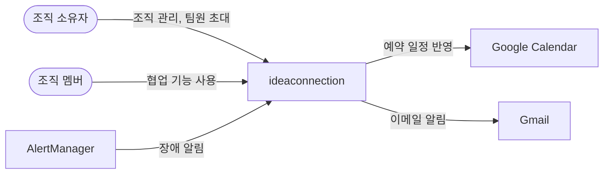
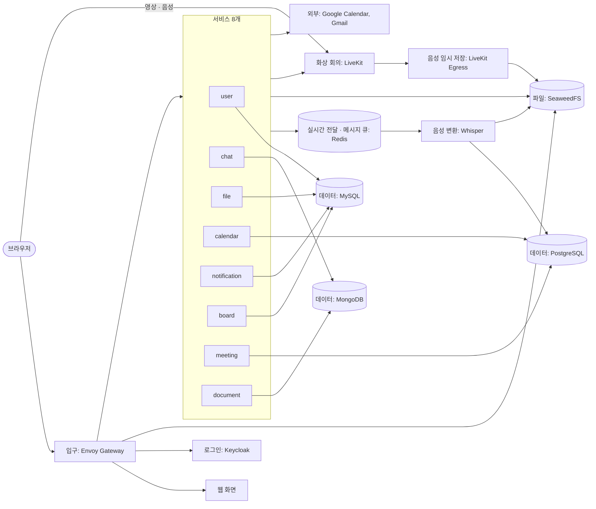
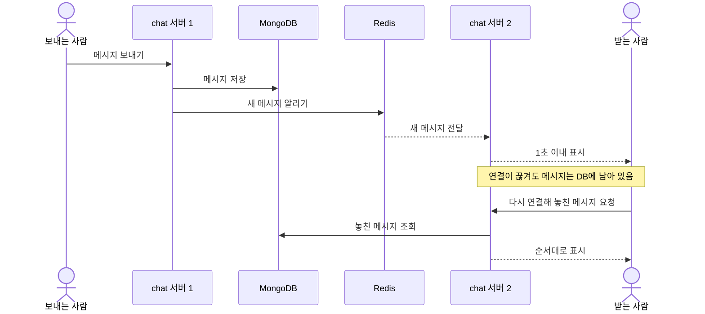
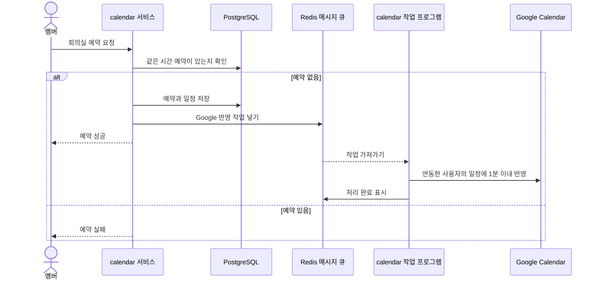
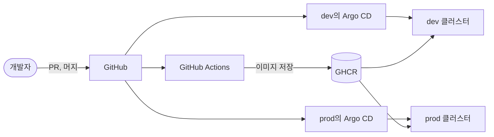

# 아키텍처

[← 요구사항](requirements.md) · [README](../README.md) · 다음: [기술 스택](tech-stack.md)

> 시스템의 큰 구조만 적습니다. 세부 설계는 담당자가 구현하면서 정하고, 배운 내용에 따라 고칩니다.

## 1. 시스템 컨텍스트

우리 시스템을 누가 쓰고, 어떤 외부 시스템과 연결되는지 보여 줍니다.

## 2. 서비스 구성도

시스템 안에 무엇이 있고 어떻게 연결되는지 보여 줍니다.

| 서비스 | 하는 일 | 요구사항 |
|---|---|---|
| user | 프로필, 조직, 초대, 멤버 권한 | US-01 ~ US-05 |
| chat | 채널, 실시간 대화, 결정 기록, 확인 요청 | US-06 ~ US-11 |
| file | 파일 업로드, 다운로드, 미리보기, 삭제 | US-12 |
| calendar | 팀 · 개인 일정, 회의실 예약, Google Calendar 반영 | US-13 ~ US-16 |
| notification | 예약 · 즉시 알림, 장애 알림 전달 | US-17 ~ US-19 |
| board | 칸반 보드, 카드, 타임라인 | US-20 ~ US-22 |
| meeting | 회의방, 화상 회의 입장, 음성 변환 요청 | US-23 ~ US-27 |
| document | 문서와 드로잉 공동 편집 | US-28 |

서비스 사이의 약속입니다.

- 서비스마다 자기 데이터만 직접 다룹니다. 다른 서비스의 데이터가 필요하면 그 서비스에 요청합니다
- 서비스끼리는 네 가지만 호출합니다: 조직 소속 확인(모든 조직 서비스 → user), 메시지를 카드로 변환(chat → board), 이메일 주소 조회(notification → user), 장애 알림을 채팅 채널로 전달(notification → chat)
- 사용자 요청에서 시작한 호출은 로그인 토큰을 그대로 넘깁니다. 예약 알림과 장애 알림처럼 사용자가 없는 호출은 Istio로 호출 서비스만 확인합니다
- 그 밖에 모니터링과 장애 알림을 위한 호출(Prometheus → 서비스, AlertManager → notification)과 회의 종료 알림(LiveKit → meeting)을 허용합니다
- 소속 확인 결과는 3초만 기억합니다. 멤버가 나가면 5초 안에 접근을 막기 위해서입니다
- 소속 확인은 새 요청만 막습니다. 그래서 멤버가 나가면 user가 Redis로 알리고, chat, document, meeting이 그 사용자의 실시간 연결을 끊습니다

## 3. 핵심 시나리오

### 채팅 전달과 복구 (US-06, US-07)

메시지를 먼저 저장하므로, 연결이 끊겨도 다시 연결하면 놓친 메시지를 볼 수 있습니다.

### 회의실 예약과 Google 반영 (US-15, US-16)

같은 시간에 동시에 예약해도 한 건만 성공합니다. Google 반영은 메시지 큐(할 일을 쌓아 두고 차례로 처리하는 대기열)를 거칩니다. 예약 응답이 Google을 기다리지 않고, 실패해도 다시 시도할 수 있습니다.

메시지 큐는 학습을 위해 Google 반영과 음성 변환 작업에 씁니다. 도구를 늘리지 않도록 Redis의 메시지 보관 기능(Redis Streams)을 씁니다. Redis가 멈춰도 예약은 성공하고 Google 반영만 빠질 수 있습니다.

### 회의 음성 변환 (US-24)

영상은 녹화하지 않고, 글로 바꾸는 데 필요한 음성만 잠시 저장합니다.

1. 회의 중에 LiveKit Egress(회의 음성을 파일로 내보내는 프로그램)가 음성을 SeaweedFS에 임시로 저장합니다
2. 회의가 끝나면 meeting 서비스가 Redis 메시지 큐에 작업을 넣고, 음성 변환 프로그램이 가져갑니다
3. 음성 변환 프로그램이 Whisper로 음성을 글로 바꾸고, 결과를 meeting의 PostgreSQL에 저장합니다
4. 변환이 끝나면 원본 음성을 지웁니다

변환은 오래 걸리므로 API 서버와 음성 변환 프로그램을 나누어 실행합니다. 그래야 회의방 요청이 밀리지 않습니다.

## 4. 배포 구성도

코드가 서버에 올라가는 과정입니다.

1. 개발자가 PR을 올리면 GitHub Actions가 코드를 검사합니다
2. 머지하면 GitHub Actions가 이미지를 만들어 GHCR에 저장하고, dev의 이미지 번호를 바꿔 `main`에 바로 올립니다
3. 그러면 Argo CD가 dev에 배포합니다
4. dev에서 확인한 이미지는 스프린트 데모 전에 PR로 prod에 올립니다
5. 문제가 생기면 `git revert`로 되돌립니다

## 5. 네트워크 · 보안

- 사용자 요청은 Envoy Gateway 하나로 들어오고 암호화된 통신만 허용합니다. 화상 회의의 영상과 음성만 LiveKit으로 직접 연결합니다
- 서비스는 내부망에만 두고, 외부에서는 bastion을 거쳐 접속합니다
- 데모는 내부망에서 합니다. 화상 회의는 브라우저가 LiveKit에 직접 연결하므로, 구현 초기에 내부망에서 실제 통화로 확인합니다
- 로그인은 Keycloak이 처리하고, Gateway와 서비스가 로그인 토큰(JWT)을 확인합니다
- 서비스끼리의 통신은 Istio로 암호화하고, 2번에 적은 호출만 허용합니다
- 소속되지 않은 조직의 데이터는 볼 수 없습니다
- 비밀번호와 키는 Git에 넣지 않고 Kubernetes Secret에 둡니다

## 6. 모니터링

- 서비스 상태는 Prometheus가 모으고 Grafana 화면에서 봅니다
- 모든 서비스가 같은 형식으로 로그를 남기고 Loki에 모읍니다
- 에러율 5%가 5분을 넘으면 AlertManager가 notification 서비스와 Discord로 알립니다. Discord는 우리 서비스가 멈췄을 때를 대비한 경로입니다
