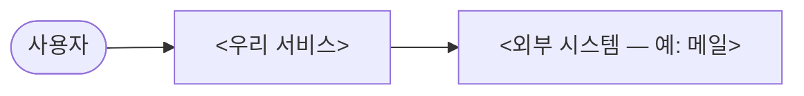
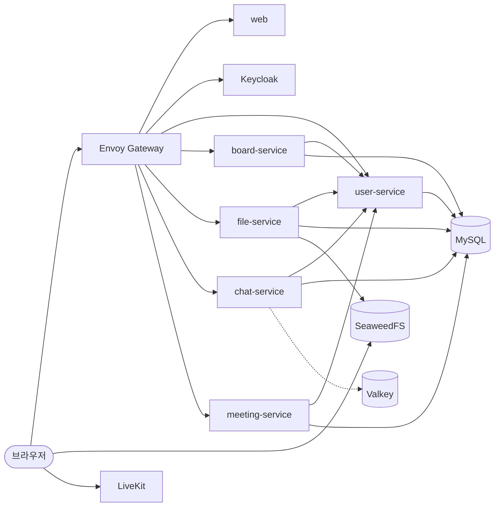
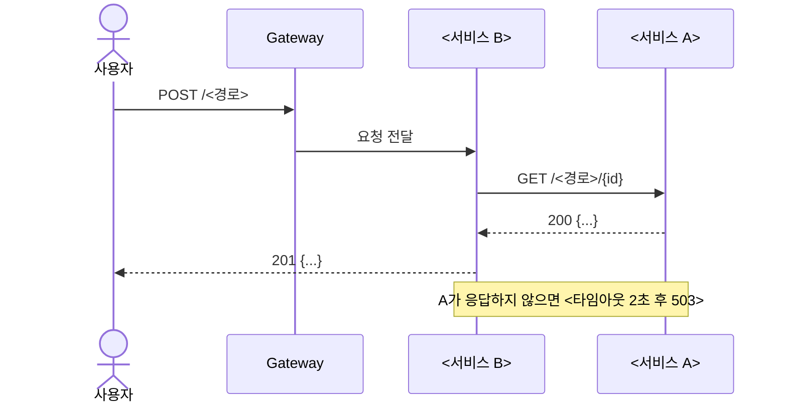
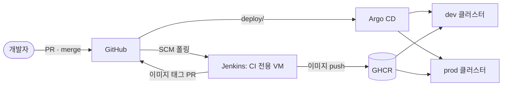

# 아키텍처

[← 요구사항](requirements.md) · [README](../README.md) · 다음: [기술 스택](tech-stack.md)

> 초안: `[미정]`은 팀 확인 전입니다.
>
> 1~4번 그림은 설계 단계에 그려 두기를 권합니다. 그림 내용은 예시이니 팀 서비스에 맞게 바꿉니다.
>
> 외부 도구로 써도 됩니다(추천: [draw.io](https://app.diagrams.net), [Excalidraw](https://excalidraw.com), [FigJam](https://www.figma.com/figjam/), [Miro](https://miro.com)). 그 경우 이 파일에는 링크와 한 줄 요약만 남깁니다.

> 그림은 Mermaid로 씁니다. GitHub에서 그림으로 바로 보입니다. 그림이 바뀌면 코드와 같은 PR에서 함께 고칩니다.

## 1. 시스템 컨텍스트

## 2. 서비스 구성도
실선은 동기 호출, 점선은 pub/sub입니다. 브라우저는 파일과 영상을 각각 SeaweedFS와 LiveKit에 직접 주고받습니다.

| 서비스 | 책임 | database · 테이블 |
|---|---|---|
| `user-service` | 프로필, 조직, 초대, 멤버와 역할(OWNER, MEMBER) | `user_service`: `profile`, `organization`, `membership`, `invitation` |
| `board-service` | 보드, 컬럼, 카드, 순서, 담당자, 기간, 간트 조회 | `board_service`: `board`, `board_column`, `card` |
| `file-service` | presigned URL 발급, 업로드 완료 확인, 목록과 삭제 | `file_service`: `file_object` |
| `chat-service` | 채널, 메시지 저장과 조회, WebSocket(STOMP) | `chat_service`: `channel`, `channel_member`, `message` |
| `meeting-service` | 회의방, LiveKit 입장 토큰 서명(유효 10분) | `meeting_service`: `meeting` |

- 사용자 ID는 Keycloak `sub`(UUID)를 그대로 쓰고, 사용자 테이블은 두지 않습니다
- 다른 서비스의 데이터는 ID로만 참조합니다. 서비스 간 외래 키와 JOIN은 금지합니다
- 서비스 간 호출은 멤버십 확인 하나뿐입니다

## 3. 핵심 시나리오 시퀀스 (1~2개)

## 4. 배포 구성도

- PR: Jenkins가 변경된 부분만 검증합니다. `services/`는 빌드, 테스트, 린트를, `deploy/`는 `validate.sh`를 실행합니다
- `main` 머지: `services/`가 바뀌면 이미지를 커밋 SHA 태그로 push하고 `image.tag` 변경 PR을 만듭니다. 이 PR을 리뷰 후 머지하면 Argo CD가 동기화합니다
- 롤백: `git revert` 후 머지
- `[미정]` prod 반영 시점, Argo CD 설치 위치(클러스터별 또는 한 곳), prod 노드 구성

## 5. 네트워크 · 보안 (보안 영역 담당)
<외부 진입점, 서비스 사이 허용 통신(NetworkPolicy), 비밀값 위치>

## 6. 관측 구성 (관측 영역 담당)
<지표 · 로그 수집 흐름 — 자세한 기준은 [관측 설계](observability.md)>
