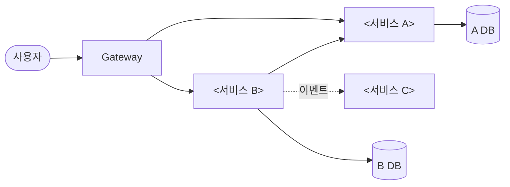
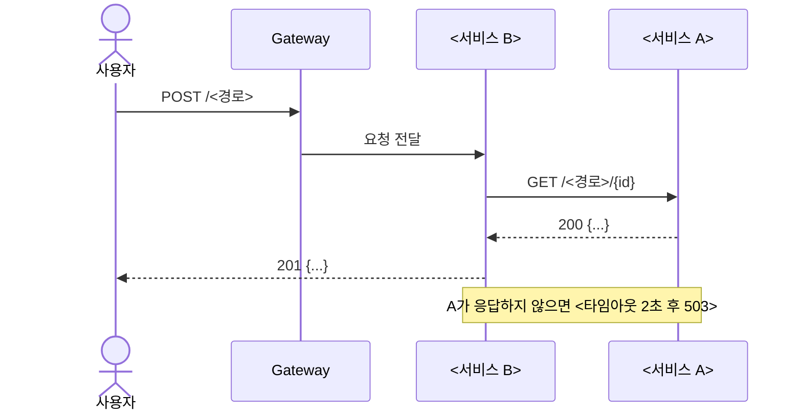
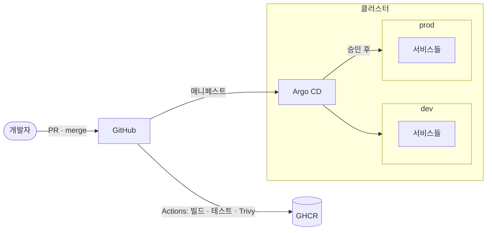

# 아키텍처

[← 요구사항](requirements.md) · [README](../README.md) · 다음: [기술 스택](tech-stack.md)

> 1~4번 그림은 설계 단계에 그려 두기를 권합니다. 그림 내용은 예시이니 팀 서비스에 맞게 바꿉니다.
> 외부 도구로 써도 됩니다(추천: [draw.io](https://app.diagrams.net), [Excalidraw](https://excalidraw.com), [FigJam](https://www.figma.com/figjam/), [Miro](https://miro.com)). 그 경우 이 파일에는 링크와 한 줄 요약만 남깁니다.

> 그림은 Mermaid로 씁니다. GitHub에서 그림으로 바로 보입니다. 그림이 바뀌면 코드와 같은 PR에서 함께 고칩니다.

## 1. 시스템 컨텍스트

## 2. 서비스 구성도
실선은 동기 호출(HTTP), 점선은 비동기(이벤트)입니다.

| 서비스 | 담당 | 책임 | DB |
|---|---|---|---|
| <서비스 A> | <이름> | | |

## 3. 핵심 시나리오 시퀀스 (1~2개)

## 4. 배포 구성도

## 5. 네트워크 · 보안 (보안 영역 담당)
<외부 진입점, 서비스 사이 허용 통신(NetworkPolicy), 비밀값 위치>

## 6. 관측 구성 (관측 영역 담당)
<지표 · 로그 수집 흐름 — 자세한 기준은 [관측 설계](observability.md)>
