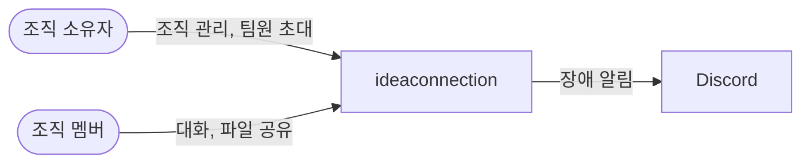
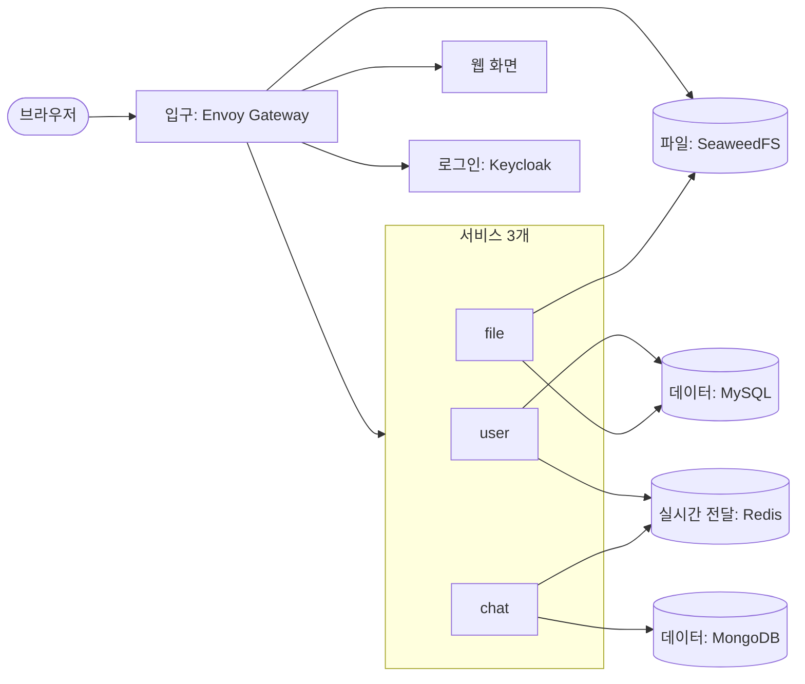
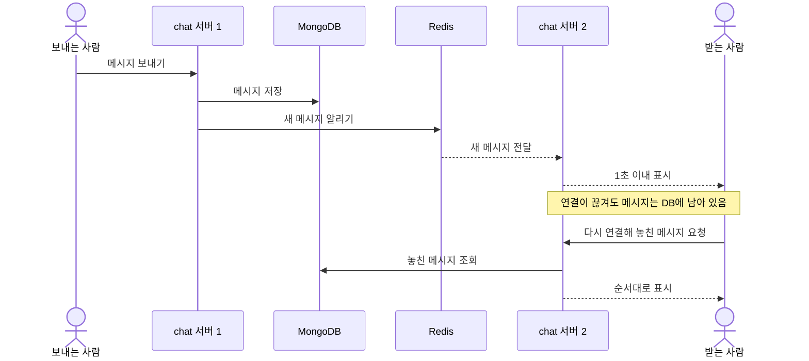
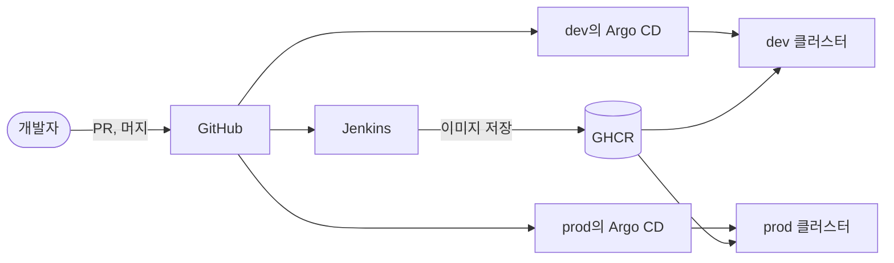

# 아키텍처

[← 요구사항](requirements.md) · [README](../README.md) · 다음: [기술 스택](tech-stack.md)

> 시스템의 큰 구조만 적습니다. 세부 설계는 담당자가 구현하면서 정하고, 배운 내용에 따라 고칩니다.

## 1. 시스템 컨텍스트

우리 시스템을 누가 쓰고, 어떤 외부 시스템과 연결되는지 보여 줍니다.

## 2. 서비스 구성도

시스템 안에 무엇이 있고 어떻게 연결되는지 보여 줍니다.

| 서비스 | 하는 일 | 요구사항 |
|---|---|---|
| user | 프로필, 조직, 초대, 멤버 권한 | US-01 ~ US-05 |
| chat | 채널, 실시간 대화, 결정 기록, 확인 요청 | US-06 ~ US-10 |
| file | 파일 업로드, 다운로드, 미리보기, 삭제 | US-08, US-11 |

서비스 사이의 약속입니다.

- 서비스마다 자기 데이터만 직접 다룹니다. 다른 서비스의 데이터가 필요하면 그 서비스에 요청합니다
- 서비스끼리는 조직 소속 확인(chat, file → user) 하나만 호출합니다. 이때 사용자의 로그인 토큰을 그대로 넘깁니다
- 그 밖에 모니터링을 위한 호출(Prometheus → 서비스)을 허용합니다
- 소속 확인 결과는 3초만 기억합니다. 멤버가 나가면 5초 안에 접근을 막기 위해서입니다
- 소속 확인은 새 요청만 막습니다. 그래서 멤버가 나가면 user가 Redis로 알리고, chat이 그 사용자의 실시간 연결을 끊습니다

## 3. 핵심 시나리오

### 채팅 전달과 복구 (US-06, US-07)

메시지를 먼저 저장하므로, 연결이 끊겨도 다시 연결하면 놓친 메시지를 볼 수 있습니다.

## 4. 배포 구성도

코드가 서버에 올라가는 과정입니다.

1. 개발자가 PR을 올리면 Jenkins가 코드를 검사합니다
2. 머지하면 Jenkins가 이미지를 만들어 GHCR에 저장하고, 새 이미지 번호를 바꾸는 PR을 올립니다
3. 그 PR을 머지하면 Argo CD가 dev에 배포합니다
4. dev에서 확인한 이미지는 스프린트 데모 전에 PR로 prod에 올립니다
5. 문제가 생기면 `git revert`로 되돌립니다

## 5. 네트워크 · 보안

- 사용자 요청은 Envoy Gateway 하나로 들어오고 암호화된 통신만 허용합니다
- 서비스는 내부망에만 두고, 외부에서는 bastion을 거쳐 접속합니다
- 데모는 내부망에서 합니다
- 로그인은 Keycloak이 처리하고, Gateway와 서비스가 로그인 토큰(JWT)을 확인합니다
- 서비스끼리의 통신은 Istio로 암호화하고, 2번에 적은 호출만 허용합니다
- 소속되지 않은 조직의 데이터는 볼 수 없습니다
- 비밀번호와 키는 Git에 넣지 않고 Kubernetes Secret에 둡니다

## 6. 모니터링

- 서비스 상태는 Prometheus가 모으고 Grafana 화면에서 봅니다
- 모든 서비스가 같은 형식으로 로그를 남기고 Loki에 모읍니다
- 에러율 5%가 5분을 넘으면 AlertManager(장애 알림 도구)가 Discord로 알립니다. 우리 서비스가 멈춰도 알림을 받을 수 있게 외부 채널을 씁니다
