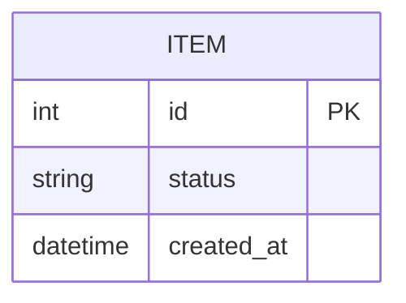

# ERD

[← README](../../README.md)

> 채울 항목의 예입니다. 팀 프로젝트에 맞게 항목을 더하거나 빼도 됩니다.
>
> 외부 도구로 써도 됩니다(추천: [dbdiagram.io](https://dbdiagram.io), [ERDCloud](https://www.erdcloud.com)). 그 경우 이 파일에는 링크와 한 줄 요약만 남깁니다.

- 서비스마다 자기 DB를 가집니다. 다른 서비스의 DB는 직접 읽지 않고 API를 호출합니다
- [dbdiagram.io](https://dbdiagram.io)의 DBML 또는 아래처럼 Mermaid로 씁니다

## <서비스 A>

## DB 테이블 변경 · 시드 데이터
| 항목 | 방법 |
|---|---|
| 테이블 변경 | <서비스 시작 때 생성 / migrations 스크립트> |
| 시드 데이터 | <scripts/seed 실행 방법> |
