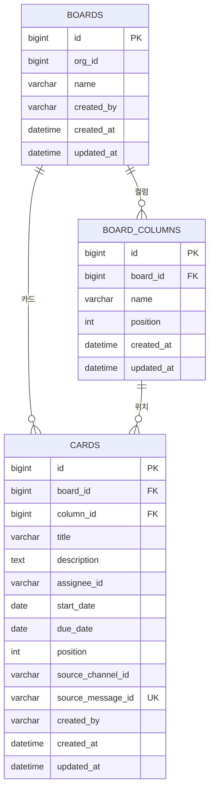

# board ERD

[← ERD](README.md)

DB: MySQL

| 표 | 꼭 지킬 것 | 이유 |
|---|---|---|
| `board_columns` | 보드를 만들면 Todo, In Progress, Done을 자동으로 만듭니다 | 컬럼 관리 화면 없이 바로 쓸 수 있습니다 |
| `cards` | `position` 숫자를 1000 간격으로 둡니다 | 카드 사이로 옮길 때 다른 카드를 거의 고치지 않습니다 |
| `cards` | `source_message_id`는 값이 있을 때 중복 금지 | 메시지당 카드 1개를 보장합니다(US-09) |
| `cards` | `assignee_id`, `source_*`는 외래 키 없이 ID만 저장 | 다른 서비스의 데이터입니다 |
