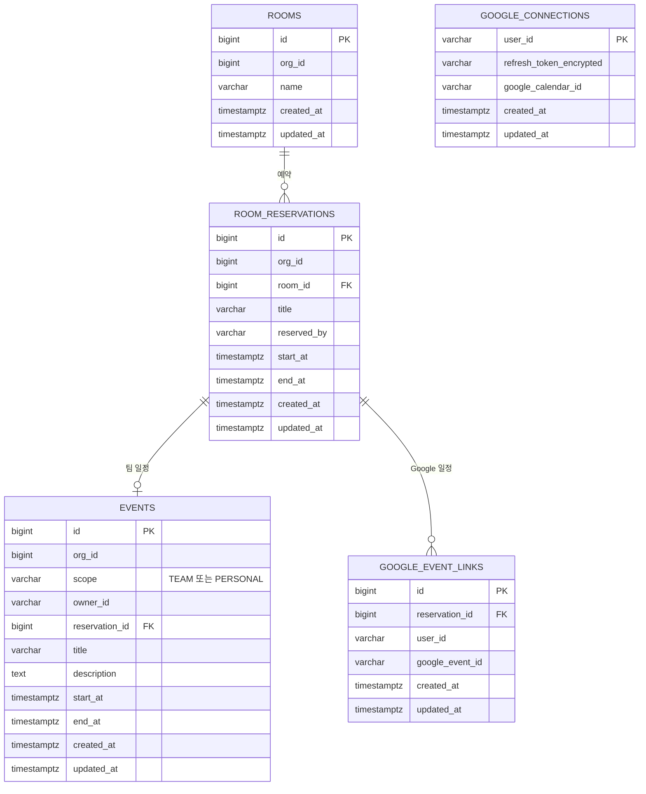

# calendar ERD

[← ERD](README.md)

DB: PostgreSQL

| 표 | 꼭 지킬 것 | 이유 |
|---|---|---|
| `room_reservations` | `EXCLUDE USING gist (room_id WITH =, tstzrange(start_at, end_at) WITH &&)` | 같은 회의실의 겹치는 시간을 DB가 막습니다(US-16). `btree_gist` 확장이 필요합니다 |
| `events` | `PERSONAL`은 `owner_id` 조건으로만 조회 | 다른 사람에게 보이지 않습니다(US-14) |
| `events` | 예약하면 팀 일정을 함께 만들고, 그 일정은 예약 API로만 바꿉니다 | 예약이 캘린더에 바로 보입니다(US-15) |
| `google_connections` | 토큰을 암호화해 저장하고 응답에 넣지 않습니다 | Google 계정 접근 권한입니다 |
| `google_event_links` | `reservation_id + user_id` 중복 금지 | 작업을 다시 처리해도 Google 일정이 늘지 않습니다 |
