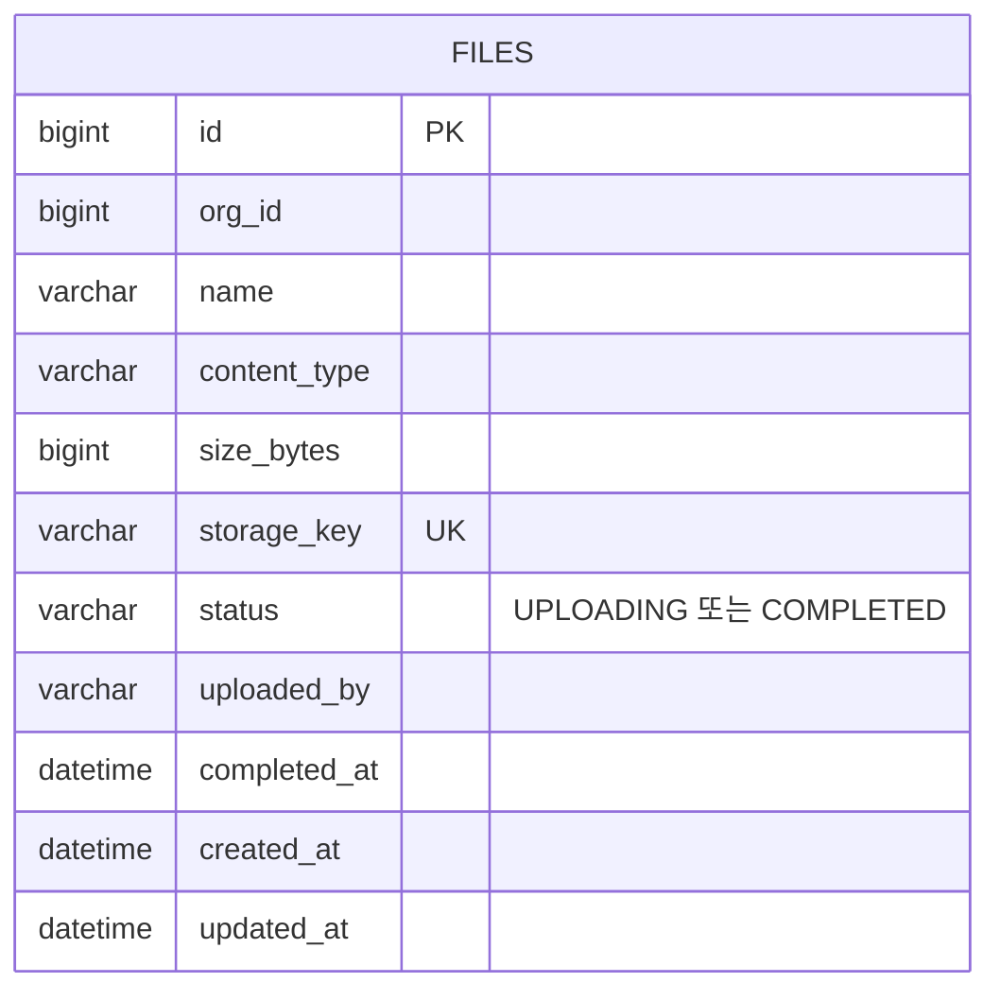

# file ERD

[← ERD](README.md)

DB: MySQL

| 표 | 꼭 지킬 것 | 이유 |
|---|---|---|
| `files` | 목록에는 `COMPLETED` 파일만 보여 줍니다 | 업로드가 끝난 파일만 표시합니다(US-12) |
| `files` | `storage_key`는 사용자가 정한 이름이 아니라 서버가 만든 값입니다 | SeaweedFS의 파일 위치를 서버가 정합니다 |
