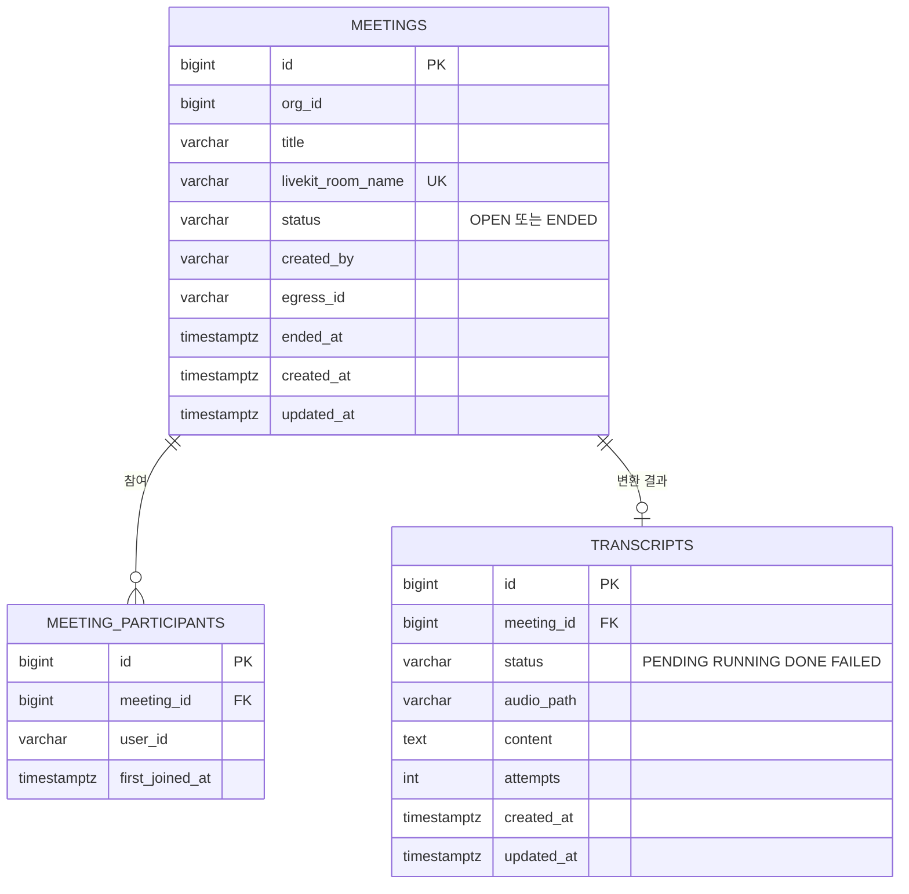

# meeting ERD

[← ERD](README.md)

DB: PostgreSQL

| 표 | 꼭 지킬 것 | 이유 |
|---|---|---|
| `meeting_participants` | `meeting_id + user_id` 중복 금지 | 다시 들어와도 한 번만 기록합니다 |
| `transcripts` | `meeting_id` 중복 금지 | 종료 알림이 두 번 와도 작업이 하나입니다 |
| `transcripts` | 변환이 끝나면 `audio_path`의 원본 음성을 지웁니다 | 원본 음성은 변환 후 삭제합니다(US-24) |
