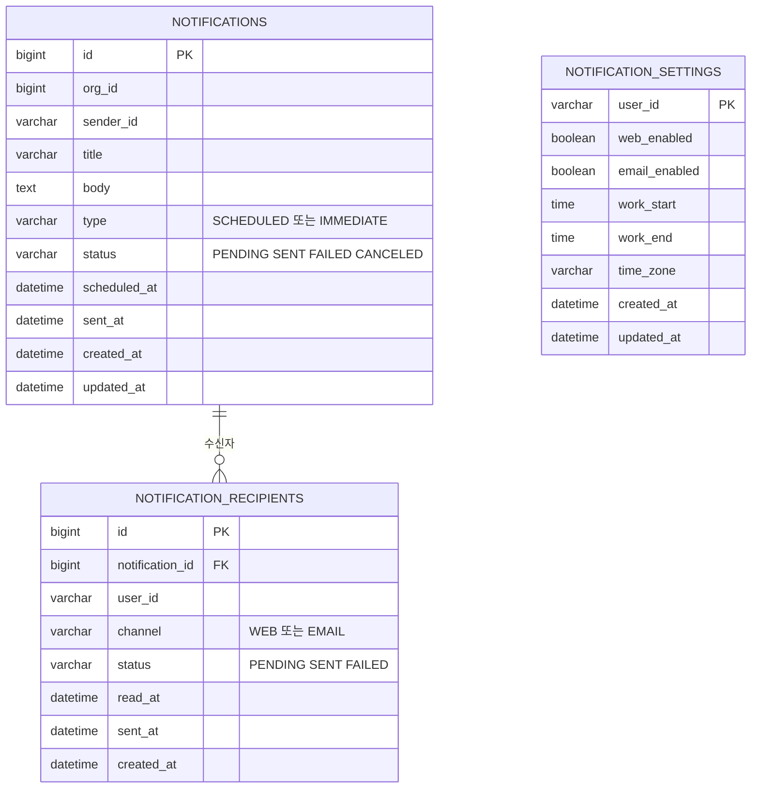

# notification ERD

[← ERD](README.md)

DB: MySQL

| 표 | 꼭 지킬 것 | 이유 |
|---|---|---|
| `notifications` | `status + scheduled_at` 인덱스 | 보낼 알림을 빠르게 찾습니다 |
| `notifications` | 보낼 알림은 `SKIP LOCKED`로 가져갑니다 | 서버가 여러 대여도 같은 알림을 두 번 보내지 않습니다 |
| `notification_recipients` | `notification_id + user_id + channel` 중복 금지 | 같은 경로로 두 번 보내지 않습니다 |
| `notification_settings` | 기본값은 웹만 켜짐 | 수신자가 경로를 고르기 전에도 알림을 받습니다(US-17) |
