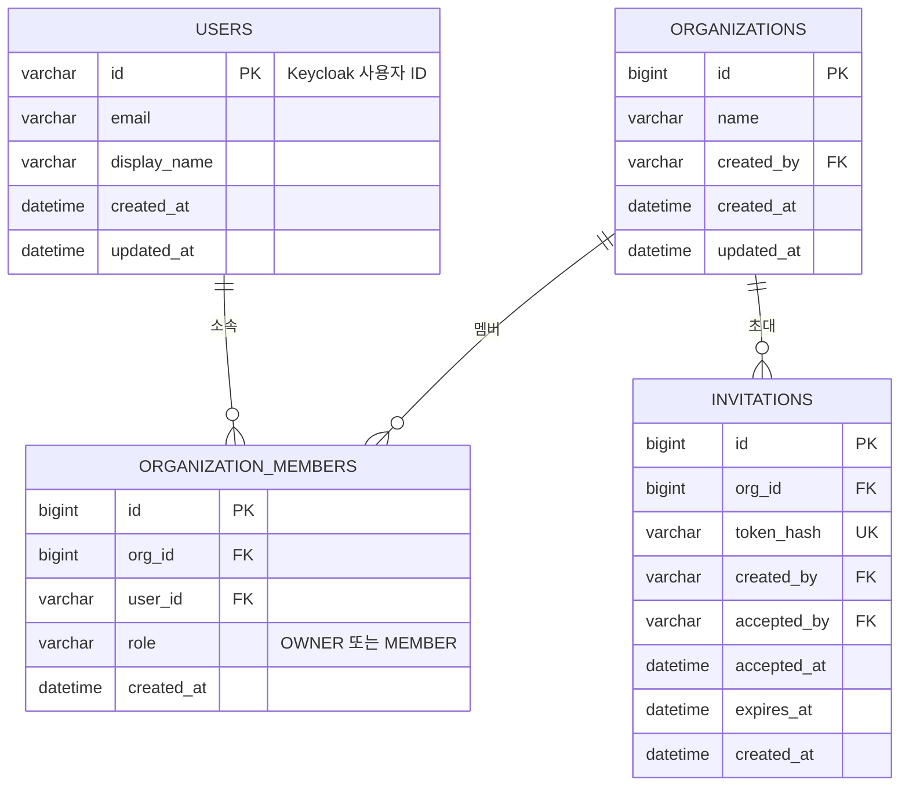

# user ERD

[← ERD](README.md)

DB: MySQL

사용자 정보는 Keycloak이 원본이고, 비밀번호는 저장하지 않습니다. 여기에는 첫 로그인 때 프로필만 저장합니다.

| 표 | 꼭 지킬 것 | 이유 |
|---|---|---|
| `users` | `id`는 Keycloak 사용자 ID를 그대로 씁니다 | 다른 서비스도 이 ID로 사용자를 가리킵니다 |
| `organization_members` | `org_id`와 `user_id` 조합은 중복 금지 | 같은 조직에 두 번 가입할 수 없습니다 |
| `organization_members` | 멤버를 제거하면 행을 지웁니다 | 삭제 즉시 소속 확인이 실패합니다(US-04) |
| `invitations` | 초대 토큰 원문이 아니라 해시만 저장합니다 | DB가 유출되어도 링크를 바로 쓸 수 없습니다 |
| `invitations` | `accepted_at`이 있으면 다시 쓸 수 없습니다 | 사용된 링크 재사용 금지(US-03) |
